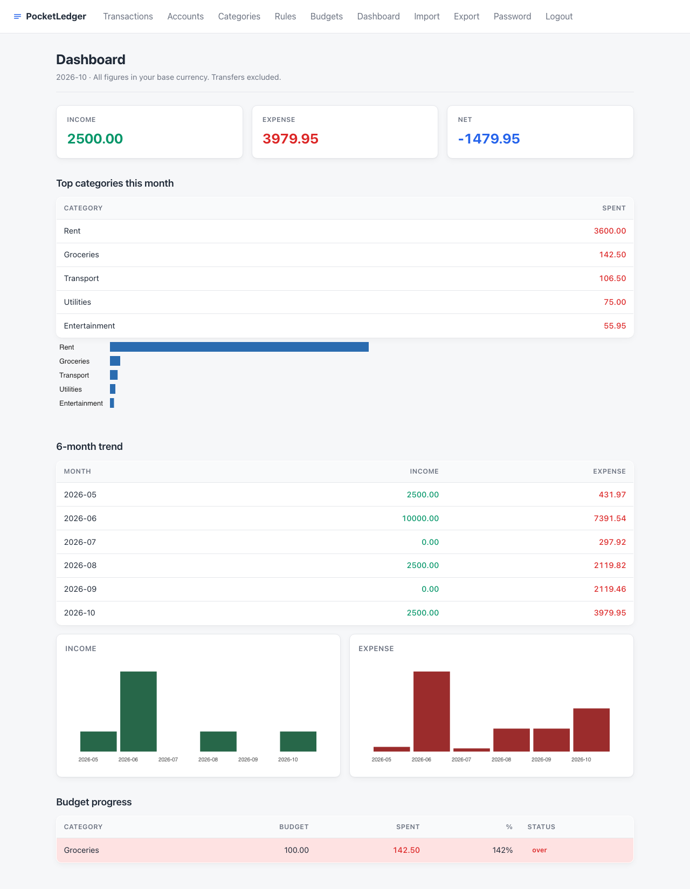
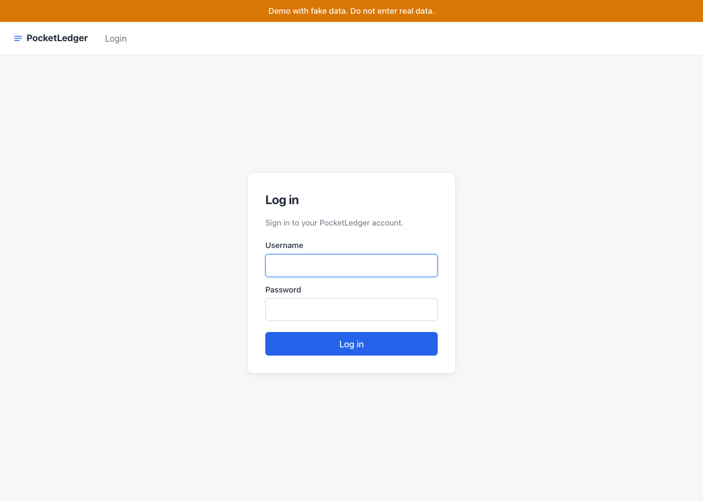
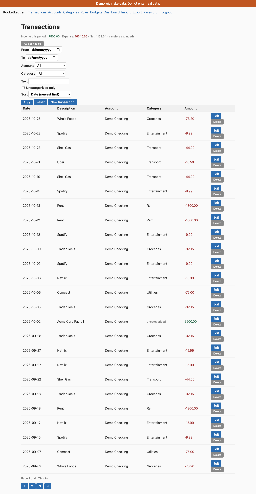

# PocketLedger

[](https://github.com/arafatsheikh098/PocketLedger/actions/workflows/ci.yml)

Privacy-first, self-hosted expense tracker. Single binary-style
deployment: Python + SQLite, served by Uvicorn behind a single
cookie-based session. No third-party network calls.



## What it does

- Multi-user (per-user data isolation, signed session cookies).
- CSV import wizard with dedup, mapping, undo, and limits.
- Categorization rules (first match wins, sticky on manual).
- Budgets per category per month with over/warning thresholds.
- Dashboard with 6-month trend, top categories, budget progress.
- CSV and XLSX export with formula-injection neutralization.
- Online backups via `sqlite3 .backup`.

## Quick start

The whole thing builds and runs from a fresh clone in under a
minute:

```
git clone <repo> pocketledger && cd pocketledger
make install
make test
.venv/bin/uvicorn app.main:app --reload
```

Open <http://127.0.0.1:8000/> and log in. There is no demo user by
default; create one with:

```
.venv/bin/python -m app.cli create-user --username alice --password alice1234
```

To try the demo with 6 months of fake data, set `SEED_ON_START=true`
and `DEMO_MODE=true` in the environment. On first boot the app
creates a `demo` / `demo1234` user with the fake transactions and
one budget that is over 80% spent.

## 📸 Visual Tour & Screenshots

| 🔐 Demo Authentication & Safe Mode | 📊 Financial Dashboard & Budget Tracking | 💳 Ledger & Categorized Transactions |
| :---: | :---: | :---: |
| [](docs/screenshots/login.png) | [](docs/screenshots/dashboard.png) | [](docs/screenshots/transactions.png) |
| *One-click demo banner in `DEMO_MODE=true`* | *6-month trends, category breakdowns & budget gauges* | *Searchable transaction log with categorization badges* |

## Deployment

Two options, both documented in [DEPLOY.md](DEPLOY.md):

1. **Local / on-prem** — `docker compose up`. SQLite lives on a
   bind-mounted volume; `scripts/backup.sh` snapshots it.
2. **Public demo on Render** — `render.yaml` provisions a free
   Web Service with a persistent disk and `DEMO_MODE=true`,
   `SEED_ON_START=true`. Anyone who hits the URL lands on a
   working demo account.

`scripts/smoke_test.sh` boots uvicorn, hits the public routes,
logs in as the demo user, downloads a CSV, and exits non-zero on
any failure. Run it locally:

```
PORT=18765 ./scripts/smoke_test.sh
```

## Architecture

```
app/
  auth/         passwords (argon2), CSRF, rate limit, session
  routers/      one router per resource (auth, accounts,
                categories, transactions, rules, budgets,
                imports, exports, dashboard)
  services/     business logic (dedup, import_batch, mapping,
                rules, budgets, exports)
  models/       SQLModel tables
  templates/    Jinja2 (HTMX for partial updates)
  static/       vendored HTMX + chart-stub.js
  demo.py       demo seeder
  config.py     pydantic-settings (env-driven)
  db.py         engine + WAL mode
scripts/        backup.sh, restore.sh, smoke_test.sh,
                fresh_clone_test.sh, capture_screenshots.py
tests/          118 tests (unit + Playwright e2e)
```

## Threat model

**Protected:**

- Passwords stored with Argon2id (`argon2-cffi`).
- Sessions are signed cookies (`itsdangerous`); tampering or
  random bytes are rejected.
- CSRF token required on every state-changing POST, including
  login.
- Login rate limit (per username+IP) backed by a DB table; brute
  force attempts return 429 after the threshold.
- Per-user data isolation: every query that touches a row scoped
  to a user goes through `scoped_query` / `scoped_get` helpers.
  Cross-user access returns 404, not 403, so user enumeration is
  not possible.
- CSV/XLSX exports sanitize formula prefixes (`=`, `+`, `-`, `@`,
  tab, CR) with a leading apostrophe to neutralize spreadsheet
  formula injection (CWE-1236).
- Production refuses to boot with the default `SECRET_KEY`.

**Not protected:**

- The database file is not encrypted at rest. Use disk encryption
  (LUKS, FileVault, BitLocker, EBS encryption) to protect a
  stolen disk image.
- No email-based password reset (out of scope; out-of-band
  password reset is required for production but is not what this
  app is for).
- No anti-CSRF on GET routes (none of them change state).
- No rate limit on the export endpoints; the per-user scoped
  query keeps one user from pulling another user's data, but a
  determined attacker with a valid session could DoS by hammering
  the export endpoints. This is acceptable for a single-user
  self-hosted app.

## Development

```
make install       # venv + pip install -e ".[dev]"
make test          # pytest (incl. Playwright e2e)
make lint          # ruff
make fresh-clone   # full clean-clone test in a tempdir
```

The fresh-clone test copies the repo to a temp dir, builds a venv,
installs, lints, runs the test suite, boots uvicorn, and hits
`/health`. If any step fails, the script exits non-zero. This is
the canary for "does the README still work?".

## License

This is a personal project. The vendored HTMX, the vendored
chart-stub, and the project-specific code are all in this repo.
No third-party network calls are made at runtime.